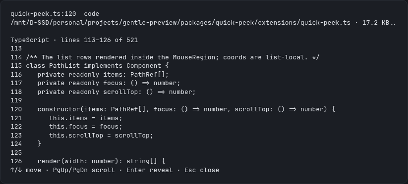
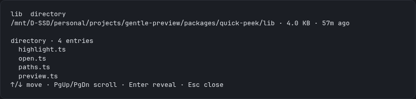
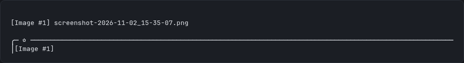
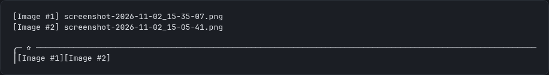

# gentle-preview

Two plugins for [Pi Coding Agent](https://pi.dev) and Gentle Shell that let you look at something without leaving the session: a file, its lines, or a picture you pasted.

| Package | What it does |
| --- | --- |
| [`gentle-quick-peek`](packages/quick-peek) | Turns the file paths of a session into previews: a code file with its lines numbered and coloured and the named line lit, an image thumbnail, or the file's name, kind, size and age. Reveals the file in your file manager when you pick it. |
| [`gentle-image-preview`](packages/image-preview) | Numbers a pasted image as `[Image #N]` instead of leaving a long path in the prompt, keeps the prompt short, and previews the picture (or shows its real path) when you hover the chip above the editor. |

Both are ports of the ideas in [midudev/better-claude](https://github.com/midudev/better-claude) quick-peek and image-preview, rebuilt on the Pi extension API rather than copied: Pi has no hook over the rendering of a built-in message, so interactions live in the plugin's own surface, with the keyboard as the primary path and the mouse as an addition in fullscreen.

## Install

Gentle Shell:

```bash
gentle-shell install npm:gentle-quick-peek
gentle-shell install npm:gentle-image-preview
```

Pi:

```bash
pi install npm:gentle-quick-peek
pi install npm:gentle-image-preview
```

`gentle-shell install npm:<package>` delegates to `pi install` against the Gentle Shell home, so both commands write the same package declaration to their respective `settings.json`.

Try a working tree without installing:

```bash
gentle-shell -e ./packages/quick-peek/extensions/quick-peek.ts
pi -e ./packages/image-preview/extensions/image-preview.ts
```

## What it looks like

`gentle-quick-peek` — a code file with the named line lit, and a directory with its first entries:





`gentle-image-preview` — one pasted image, and two images numbered in the same draft:





These frames come from a real session running the packaged extensions, captured from the running TUI and re-rendered as static frames for legibility.

## Platforms

| Platform | State |
| --- | --- |
| Linux (Omarchy / Wayland) | Primary development and manual verification target. |
| macOS | Covered by CI for unit tests and typecheck; reveal and clipboard behaviour needs a manual check on a Mac. |
| Windows | Covered by CI for unit tests and typecheck; reveal and clipboard behaviour needs a manual check. |
| WSL | Covered by CI for unit tests and typecheck; the Windows-side reveal path needs a manual check. |

Mouse hover and click require Pi's fullscreen interface. Every interaction also has a keyboard path, because in regular mode the terminal owns mouse input.

## Development

```bash
npm install
npm test           # every package
npm run typecheck
npm run pack:check # npm pack --dry-run in each package
```

One package only:

```bash
npm test -- packages/quick-peek/tests
```

Tests run on `node --test` with Node's own type stripping; there is no test framework and no runtime dependency.

## Layout

```text
packages/
  quick-peek/       gentle-quick-peek   — extensions/, lib/, tests/
  image-preview/    gentle-image-preview — extensions/, lib/, tests/
scripts/run-tests.mjs                   — runs every suite, cleans its temp dirs
odd/tasks/gentle-preview.md             — the feature document this work follows
```

## Contributing

**Every pull request must reference an accepted issue, and only the repository owner merges.** Work on an unaccepted issue may be closed without review, and a maintainer approving a change never means you may merge it yourself.

Read [CONTRIBUTING.md](CONTRIBUTING.md) for the branch naming, the checks a pull request must pass, and the rules these packages hold to.

## License

MIT © efolchmontiel.

The ideas these plugins port come from [midudev/better-claude](https://github.com/midudev/better-claude) (MIT © Miguel Ángel Durán), which implements them for Claude Code. This repository is an independent port to the Pi extension API: no source code, asset or test was copied. See [THIRD_PARTY_NOTICES.md](THIRD_PARTY_NOTICES.md) for the full attribution and the licence of every host and development dependency.
