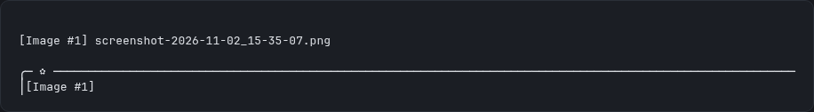
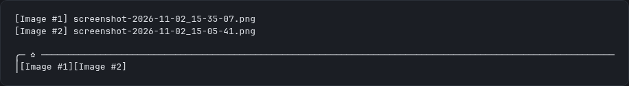

# gentle-image-preview

A Pi / Gentle Shell extension that replaces long pasted-image paths with short,
numbered `[Image #N]` tokens — and lets you hover or click them to see what
they point at.

## Install

Gentle Shell:

```bash
gentle-shell install npm:gentle-image-preview
```

Pi:

```bash
pi install npm:gentle-image-preview
```

Without installing, from a checkout of this repository:

```bash
pi -e ./packages/image-preview/extensions/image-preview.ts
```

## Examples






The second frame shows the numbering rule: each image pasted into the same draft
takes the next number, and an emptied draft starts again at `[Image #1]`.


Both frames come from a real session running the packaged extension, captured
from the running TUI and re-rendered as a static frame for legibility.

## What it does

Pasting an image from the clipboard normally inserts a long temp-file path into
the editor. With this extension, the paste shortcut saves the clipboard image
to your pictures folder (or a bounded temp cache when there is none) and inserts
a compact token instead, numbered inside the draft (1, 2, 3, …):

```
Look at this [Image #1] compared with [Image #2]
```

The mapping from token to real file is persisted in the session (via a custom
entry), so tokens survive session reloads and stay resolvable on the current
branch.

## The `[Image #N]` token

- `N` belongs to the prompt draft, not to the session: a draft that holds no
  image starts again at 1, so the next paste after you clear the editor is
  `[Image #1]` once more. Inside a draft the number always continues above the
  highest token already there. Every sent prompt carries its own refs block, so
  the history stays unambiguous even when a number is used again later.
- The token is plain text. Tokens whose mapping is unknown (for example, text
  you typed yourself) are left verbatim and simply have no entry in the refs
  block.

## What the model receives

Before your prompt reaches the model, the extension appends a trailing
`[Image refs]` block mapping every **known** token to its absolute path, in
ascending order:

```
Look at this [Image #1] compared with [Image #2]

[Image refs]
[Image #1] = /home/you/Pictures/screenshots/pasted-2026….png
[Image #2] = /home/you/Pictures/screenshots/pasted-2026….png
```

Your own message text is never dropped or rewritten; the block is appended
after it. Unknown tokens produce no line.

## Paste shortcut

- Default: `ctrl+shift+v` — deliberately **not** `ctrl+v`, which is Pi's
  built-in clipboard paste (`app.clipboard.pasteImage`) and may already be
  bound by another extension in your setup.
- Override it once per session with an environment variable:

  ```
  GENTLE_IMAGE_PREVIEW_SHORTCUT=ctrl+alt+v pi
  ```

  Pointing it at `ctrl+v` explicitly opts into replacing Pi's built-in paste;
  the last registered extension wins.
- The environment variable is read at session start; changing it requires
  starting a new session (or restarting).

### Clipboard backends (per platform)

The shortcut tries the available backends in order and **does nothing** when
none can read an image, so Pi's own paste behaviour stays intact:

- **macOS**: `pngpaste -` (homebrew), if installed.
- **Windows**: PowerShell `System.Windows.Forms.Clipboard::GetImage`, saved as
  PNG to a temp file.
- **WSL**: the same PowerShell script through `powershell.exe` Windows interop,
  with the path converted back via `wslpath -u`.
- **Linux**: `wl-paste` (Wayland) then `xclip` (X11), for PNG and JPEG
  payloads.

## Chip band above the editor

While a draft contains `[Image #N]` tokens, a widget above the editor shows one
chip per token with the image's file name. When the mouse reaches the band
(see limits below):

- **Hovering** a chip reveals its real path with pixel dimensions, and an
  inline image preview when the terminal supports images (Kitty / iTerm2
  protocols).
- **Clicking** a chip opens the image in the system viewer.

There is always a keyboard path: the `/image-paths` command lists every token
in the session with its absolute path.

## Opening images (per platform)

| Platform  | Command                                  |
| --------- | ---------------------------------------- |
| macOS     | `open <path>`                            |
| Windows   | `cmd /c start "" <path>`                 |
| WSL       | `wslpath -w` then `cmd.exe /c start ""`  |
| Linux     | `xdg-open <path>`                        |

## Storage and limits

- A pasted image is something you refer to again, so it does not go to the temp
  dir while a real pictures folder exists. Destination, first match wins:
  `GENTLE_IMAGE_PREVIEW_DIR`, `OMARCHY_SCREENSHOT_DIR`,
  `$XDG_PICTURES_DIR/screenshots`, an existing `~/Pictures/screenshots`, and
  only then `$TMPDIR/gentle-preview-paste/` (at most 200 files, oldest evicted).
- The temp cache is the only directory this extension ever prunes. A folder you
own is never cleaned, and an image identical to one already there reuses that
  file instead of writing a duplicate.
- Files are named `pasted-<timestamp>.<ext>`.
- Inline previews are capped at 40×8 terminal cells and 8 MB per image; larger
  files show the path and dimensions only.
- **The editor box itself cannot be hovered.** Pi routes mouse input only in
  fullscreen mode, so hover and click on the chip band work when Pi runs
  fullscreen; in regular mode the band still renders (chips and shortcuts), and
  `/image-paths` covers lookup from the keyboard.
- Clipboard reading requires the platform helper to be available (`pngpaste`,
  `wl-paste`/`xclip`, or PowerShell); without one, pasting images through this
  extension silently does nothing.

## Install

```
pi install npm:gentle-image-preview
# or, in Gentle Shell:
gentle-shell install npm:gentle-image-preview
```
