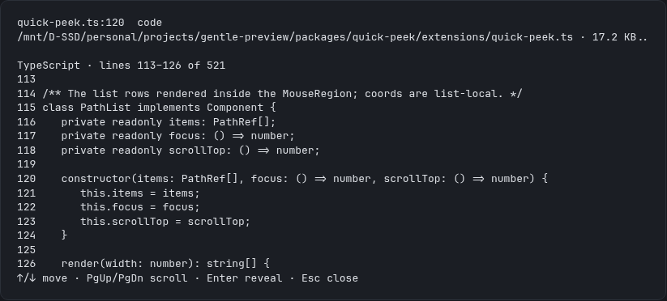
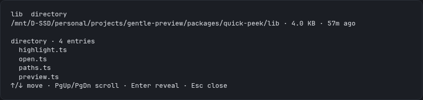

# gentle-quick-peek

Peek at a file without leaving your [Pi](https://pi.dev) / Gentle Shell session.
Ported from midudev's Claude Code `quick-peek` plugin to the Pi extension API.

From the current session transcript (or from an explicit argument), a file path
can be inspected in place: a code file shows numbered, syntax-highlighted lines
with the `:N` line illuminated; an image shows an inline thumbnail when the
terminal supports it; and every preview shows name, type, size and age.

## Install

Pi:

```bash
pi install npm:gentle-quick-peek
```

Gentle Shell:

```bash
gentle-shell install npm:gentle-quick-peek
```

Without installing, from a checkout of this repository:

```bash
pi -e ./packages/quick-peek/extensions/quick-peek.ts
```

## Usage

| Action | Command or key |
| --- | --- |
| Preview a path, optionally at a line and column | `/peek src/app.ts:42` · `/peek src/app.ts:42:7` |
| List the paths this session has mentioned | `alt+o` |
| Move through the list | `↑` / `↓`, `PageUp` / `PageDown` |
| Reveal the focused file or folder | `Enter`, or a click in fullscreen |
| Close the preview | `Esc` |

**Command:** `/peek [path[:line[:column]]]`

- Without arguments, the overlay lists the file paths found in the current
  session transcript (user messages, assistant text, tool-call arguments and
  tool results) and previews the focused one. Only paths that resolve to an
  existing file or directory are listed. Directories are included on purpose —
  a folder previews its first entries — but they are listed after the files and
  marked with a trailing `/`, so a reply that names a folder and its files does
  not make the folder look like one more file.
- With an argument, that path is previewed directly. `:line` and
  `:line:column` suffixes are honoured: the requested line is marked and the
  window is centered around it.

**Shortcut:** `alt+o` — same as `/peek` with no argument. (`alt+p` was
avoided deliberately: it is a default keybinding for "cycle to previous model"
on Windows and WSL.)

### Keyboard (primary path)

| Key | Action |
| --- | --- |
| `↑` / `↓` | Move focus through the path list |
| `PgUp` / `PgDn` | Scroll the preview window |
| `Enter` | Reveal / open the focused file (see below) |
| `Esc` | Close the overlay |

### Mouse (additive, fullscreen only)

In fullscreen mode, hovering a path row moves the preview focus to it and a
left click reveals the file. Mouse events are ignored outside fullscreen (Pi
routes normalized mouse input to extensions only there) — the keyboard always
works.

## Examples





Both frames come from a real session running the packaged extension, captured
from the running TUI and re-rendered as a static frame for legibility.

## Per-platform reveal behaviour

`Enter` (or a click) never throws; failures surface as notifications.

| Platform | File | Directory |
| --- | --- | --- |
| macOS | `open -R <file>` (reveals in Finder) | `open <dir>` |
| Windows | `explorer /select,<file>` | `explorer <dir>` |
| WSL | `explorer.exe /select,<windows-path>` via `wslpath -w` | `explorer.exe <windows-path>` |
| Linux (incl. Omarchy) | `xdg-open <containing dir>` | `xdg-open <dir>` |

The WSL path conversion runs `wslpath -w` (3 s timeout) when
`WSL_DISTRO_NAME` or `WSL_INTEROP` is set; if it fails, the reveal is reported
as a notification instead of guessing.

**Documented Linux fallback:** `xdg-open` cannot select a file, so on plain
Linux the containing directory is opened instead. (The original plugin used
the `org.freedesktop.FileManager1` D-Bus interface; that protocol hop is not
implemented here.)

Spawns are bounded (5 s timeout, then killed) and happen only from an explicit
user action — never when the extension loads.

## Previews

- **Code / text** — first 20 lines (14 in the overlay window, scrollable with
  `PgUp`/`PgDn`), line numbers, total line count, guessed language, and a
  small dependency-free regex highlighter (keywords, strings, comments,
  numbers) themed with Pi's syntax tokens.
- **Image** — mime type plus pixel dimensions parsed cheaply from the file
  header (PNG, GIF, WebP VP8/VP8L/VP8X, JPEG). When the terminal supports
  inline images (Kitty / iTerm2 protocols), the image renders inline; the
  terminal-capability fallback shows a plain-text summary instead.
- **Directory** — the first entries and the total count.
- **Binary / other** — metadata only, with a note.

## Documented limits

- Text is never read for files larger than 1 MB or containing a NUL byte;
  those fall back to a metadata-only preview.
- The highlighter is line-local: a block comment opened on one line is styled
  only to the end of that line.
- Path extraction is heuristic. Absolute paths, `~/...`, `./...`, `../...`,
  relative paths with separators, bare filenames with an extension, and
  backticked paths containing spaces are recognised; URLs are ignored.
  Relative paths resolve against the session working directory first and the
  project root second; anything that does not exist is kept unresolved and
  skipped by the caller.
- The peek cannot be triggered by hovering a path inside built-in chat
  messages: Pi exposes no render hook for built-in messages (E3 in the
  project ODD doc). The overlay opened by `/peek` / `alt+o` is the extension's
  own surface, so that is where keyboard and mouse work.
- Thumbnail rendering depends on the terminal's image protocol support and is
  not verified without real terminal emulation (see the project ODD doc, S8).
